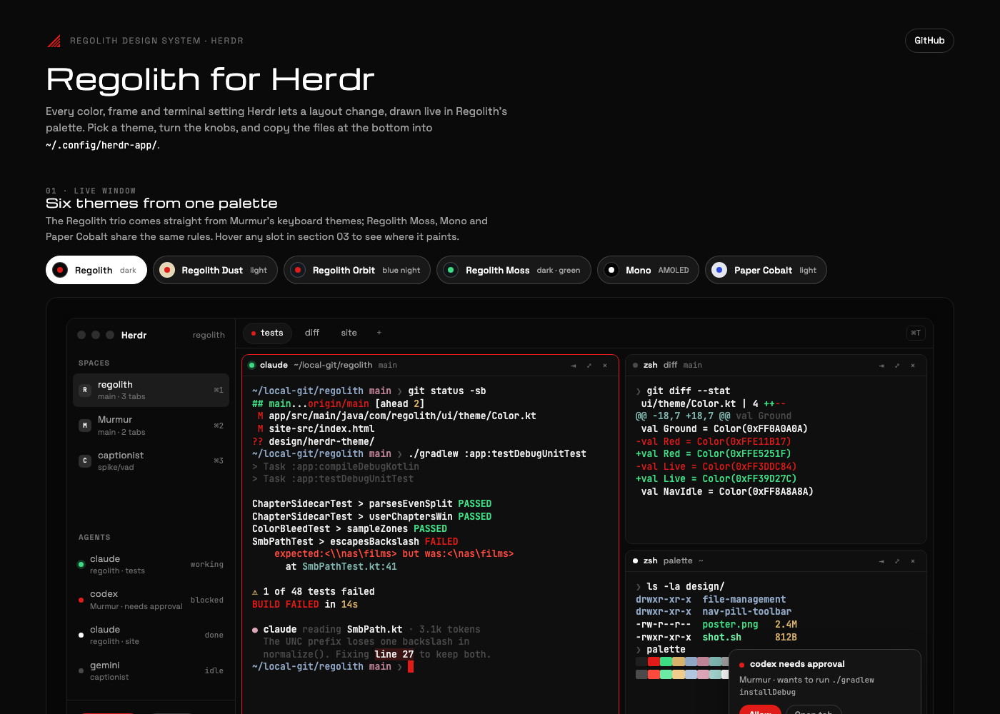
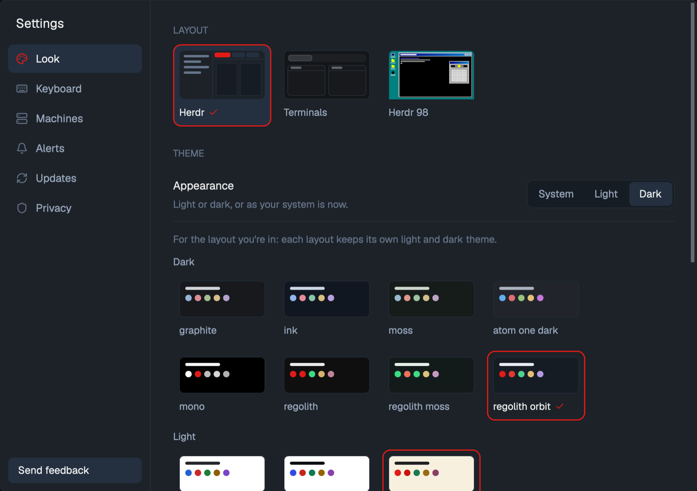

# Regolith for Herdr

Six themes for [Herdr](https://herdr.dev), drawn from the Regolith design system: a black ground, quiet greys, and one red for the thing that needs you.

**[See them live →](https://jmeza081.github.io/herdr-regolith/)** Every theme in a working Herdr window, with knobs for fonts, pane frames and glass.



## The themes

| Theme | Kind | Accent |
|---|---|---|
| `regolith` | dark | red |
| `regolith-orbit` | dark, blue night | red |
| `regolith-moss` | dark, green | green |
| `mono` | dark, AMOLED black | white |
| `regolith-dust` | light, warm sand | red |
| `paper-cobalt` | light, cool grey | cobalt |

Each file sets the terminal colors (background, text, cursor, selection and all 16 ANSI colors) and every panel color Herdr names, so the sidebar, tabs, menus, toasts and agent status dots all match.

## Install

### One line

Paste this into a terminal:

```sh
curl -fsSL https://raw.githubusercontent.com/Jmeza081/herdr-regolith/main/install.sh | sh
```

It copies the six theme files into `~/.config/herdr-app/themes/`. Nothing else is touched. Run it again any time to update.

### By hand

Download the files you want from [`themes/`](themes) and put them in `~/.config/herdr-app/themes/`. Or clone the repo:

```sh
git clone https://github.com/Jmeza081/herdr-regolith.git
cp herdr-regolith/themes/*.json ~/.config/herdr-app/themes/
```

Herdr picks up new theme files on its own. You don't need to restart it.

## Pick a theme

1. Open Herdr's Settings with **⌘,** and choose **Look**.
2. Under **Theme**, the new themes appear beside Herdr's own. Click one under **Dark** and, if you like, one under **Light**.
3. Set **Appearance** to **System** to switch between them with macOS.


Each layout keeps its own light and dark pick, so Herdr, Terminals and Herdr 98 can each look different.

| Regolith Orbit, dark | Regolith Dust, light |
|---|---|
|  |  |

Prefer the command line? This sets the theme for the layout you're in:

```sh
herdr-app do app.theme --name regolith
```

## Go further: fonts, frames and glass (optional)

A theme only sets colors. A layout file can also change the terminal font, line height, pane corners, gaps, the pane header and window blur. The [showcase site](https://jmeza081.github.io/herdr-regolith/#h-files) builds these settings for you as you turn its knobs. Copy them into `~/.config/herdr-app/layouts/main.json`:

- **Root keys** go on the layout's top-level node, for example:

  ```json
  { "theme": "regolith", "font": "JetBrains Mono", "font_size": 13, "terminal_line_height": 1.35, "terminal_padding": [14, 12] }
  ```

- **Pane frame** settings go on the `main` block's `content.pane`.

Back up `main.json` first. If the file has a mistake, Herdr keeps the last good version and writes the reason to `layout.error`. **Ctrl+Alt+Shift+Esc** always resets to the default layout.

## Uninstall

```sh
cd ~/.config/herdr-app/themes
rm regolith.json regolith-dust.json regolith-orbit.json regolith-moss.json mono.json paper-cobalt.json
```

Then pick another theme in Settings.

## Make your own

Every theme is plain JSON:

```json
{
  "background": "#0F0F0F",
  "foreground": "#EDEDED",
  "selection": "#3A1412",
  "cursor": "#E11B17",
  "ansi": ["16 colors, normal then bright"],
  "colors": { "accent": "#E11B17", "chrome": "#0A0A0A", "...": "..." }
}
```

Only `background`, `foreground`, `selection` and `ansi` are required; Herdr works out the panel colors from those. Anything under `colors` overrides it. Copy one of these files, rename it, and edit. The [showcase site](https://jmeza081.github.io/herdr-regolith/#h-slots) lists every color name and shows where it paints.

Don't name a theme `graphite`, `ink`, `moss` or `paper`. Herdr ships themes with those names, and yours would be hidden.

## Credits

Colors come from the Regolith app and the Murmur keyboard's named themes. Herdr is its own project; this repo only adds theme files.
