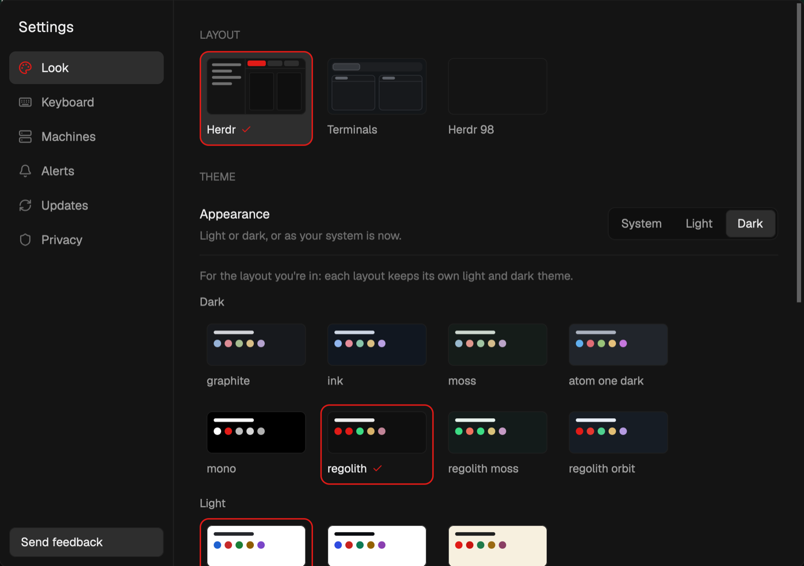
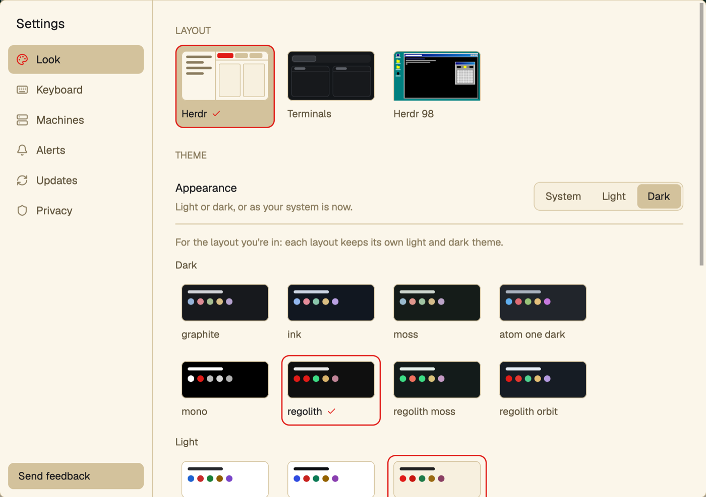

# Regolith for Herdr

Six themes for [Herdr](https://herdr.dev), drawn from the Regolith design system: a black ground, quiet greys, and one red for the thing that needs you.

**[See them live →](https://jmeza081.github.io/herdr-regolith/)** Every theme in a working Herdr window, with knobs for fonts, pane frames and glass.


## The themes

| Theme | Kind | Accent |
|---|---|---|
| `regolith` | dark | red |
| `regolith-orbit` | dark, blue night | red |
| `regolith-moss` | dark, green | green |
| `mono` | dark, AMOLED black | white |
| `regolith-dust` | light, warm sand | red |
| `paper-cobalt` | light, cool grey | cobalt |

Each file sets the terminal colors (background, text, cursor, selection and all 16 ANSI colors) and every panel color Herdr names, so the sidebar, tabs, menus, toasts and agent status dots all match.

## Install

### One line

Paste this into a terminal:

```sh
curl -fsSL https://raw.githubusercontent.com/Jmeza081/herdr-regolith/main/install.sh | sh
```

It copies the six theme files into `~/.config/herdr-app/themes/`. Nothing else is touched. Run it again any time to update. For the full Regolith look, see [Regolith Glass](#regolith-glass-optional).

### By hand

Download the files you want from [`themes/`](themes) and put them in `~/.config/herdr-app/themes/`. Or clone the repo:

```sh
git clone https://github.com/Jmeza081/herdr-regolith.git
cp herdr-regolith/themes/*.json ~/.config/herdr-app/themes/
```

Herdr picks up new theme files on its own. You don't need to restart it.

## Pick a theme

1. Open Herdr's Settings with **⌘,** and choose **Look**.
2. Under **Theme**, the new themes appear beside Herdr's own. Click one under **Dark** and, if you like, one under **Light**.
3. Set **Appearance** to **System** to switch between them with macOS.



Each layout keeps its own light and dark pick, so Herdr, Terminals and Herdr 98 can each look different.

| Regolith Orbit, dark | Regolith Dust, light |
|---|---|
|  |  |

Prefer the command line? This sets the theme for the layout you're in:

```sh
herdr-app do app.theme --name regolith
```

## Regolith Glass (optional)

Themes only set colors. **Regolith Glass** is a layout that adds the rest of the Regolith look, and it works with any of the six themes:

- The window blurs your desktop behind it. The sidebar, tab bar and terminals are see-through (terminals at 90%), so the blur shows everywhere except the Files and Changes panels.
- The focused pane has no red outline.
- **Agents list:** the status comes first as a dot, then the agent's name, a bar and the program (`~ · Regolith theme | Claude`), and the status as a word at the end. Everywhere Herdr showed a spinning ring for a working agent (agents list, tabs, pane headers, ⌘P picker) there's a green dot that breathes instead. Section headers are small capitals with count badges, and the agent you're looking at sits on a raised card.
- **Remote Control badge:** a Claude Code session with Remote Control on shows a small dish in the agents list and a "Remote" tag in its pane header, so you can tell at a glance which panes you can reach from your phone. It checks every few seconds and only sees sessions on this computer.
- **Space icons** use the theme's accent, Regolith red in the Regolith themes, in the sidebar and in the ⌘P picker. Each space gets a moon phase instead of its first letter. A color you pick for a space yourself still wins.
- **Icons:** search is a telescope, settings an orbit, files the Regolith strata, pin a planted flag, and so on, in the sidebar, tabs and pane headers.
- **Program icons** (Claude, git, Docker…) draw in one color, white on dark themes and near-black on light ones, through `programs.json`. Herdr's own icon files are kept; only the six that have more than one color stay as they are. The installer adds `programs.json` only if you don't have one, and it applies in every layout.

Install the themes and the layout together:

```sh
curl -fsSL https://raw.githubusercontent.com/Jmeza081/herdr-regolith/main/install.sh | sh -s -- --glass
```

If Herdr is open, the installer switches it to Regolith Glass with the Regolith theme. Otherwise pick **Regolith Glass** under **Layout** in Settings › Look. Any of the six themes works on top of it.

The ⌘P shortcut still opens Herdr's own picker. To open the Regolith one, change `"cmd-p"` in `~/.config/herdr-app/keys.json` to `"mod.open:regolith-picker"`. The search button in the sidebar already opens it.

> **Heads-up: these panels won't update on their own.** Herdr doesn't let you edit its built-in panels, so Regolith Glass uses copies of seven of them: the agents list, the spaces list, the ⌘P picker, the sidebar's top and bottom bars, the tab bar, the pane header and the Add machine dialog (`regolith-agents`, `regolith-spaces`, `regolith-picker`, `regolith-chrome`, `regolith-tabs`, `regolith-pane`, `regolith-machine-add`). Herdr updates its own panels, never copies. When Herdr improves one of those panels, you'll keep the older version until this repo is updated and you run the installer again. If a Herdr update ever breaks a copy, switch back to the **Herdr** layout; the themes keep working there.

### Your own layout

To change fonts, pane corners, gaps or blur yourself, copy a layout first; Herdr replaces its built-in layouts every time it starts:

```sh
herdr-app do layout.clone '{"name":"regolith-glass","as":"my-layout"}'
```

Then edit `~/.config/herdr-app/layouts/my-layout.json`. The [showcase site](https://jmeza081.github.io/herdr-regolith/#h-files) builds the settings for you as you turn its knobs: **root keys** go on the layout's top-level node, and **pane frame** settings go on the `main` block's `content.pane`. If the file has a mistake, Herdr keeps the last good version and writes the reason to `layout.error`. **Ctrl+Alt+Shift+Esc** always resets to the default layout.

## Uninstall

```sh
cd ~/.config/herdr-app
rm themes/regolith.json themes/regolith-dust.json themes/regolith-orbit.json themes/regolith-moss.json themes/mono.json themes/paper-cobalt.json
# if you installed Regolith Glass, switch to another layout first, then:
rm layouts/regolith-glass.json
rm -r mods/regolith-agents mods/regolith-spaces mods/regolith-picker mods/regolith-chrome mods/regolith-tabs mods/regolith-pane mods/regolith-machine-add
```

Then pick another theme in Settings.

## Make your own

Every theme is plain JSON:

```json
{
  "background": "#0F0F0F",
  "foreground": "#EDEDED",
  "selection": "#3A1412",
  "cursor": "#E11B17",
  "ansi": ["16 colors, normal then bright"],
  "colors": { "accent": "#E11B17", "chrome": "#0A0A0A", "...": "..." }
}
```

Only `background`, `foreground`, `selection` and `ansi` are required; Herdr works out the panel colors from those, and anything under `colors` overrides it. In these files `canvas` and `chrome` end in alpha (`E6` and `8C`) so the blur shows through in Regolith Glass; layouts without blur still look solid.

If you build your own glass layout, know that Herdr adds the opacity of every layer at a spot together. Regolith Glass therefore clears the theme's `background` in the layout's `colors`, sets `terminal_opacity` to 0, and lets one layer do the tinting: the pane frame's `canvas` (90%) behind terminals and `chrome` (55%) in the sidebar and bars. Copy one of these files, rename it, and edit. The [showcase site](https://jmeza081.github.io/herdr-regolith/#h-slots) lists every color name and shows where it paints.

Don't name a theme `graphite`, `ink`, `moss` or `paper`. Herdr ships themes with those names, and yours would be hidden.

## Credits

Colors come from the Regolith app and the Murmur keyboard's named themes. Herdr is its own project; this repo only adds theme files.
